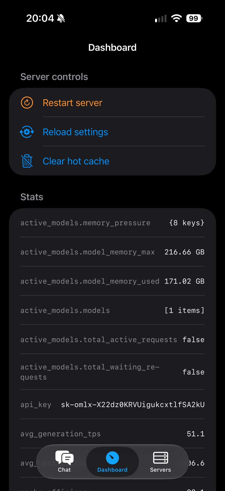
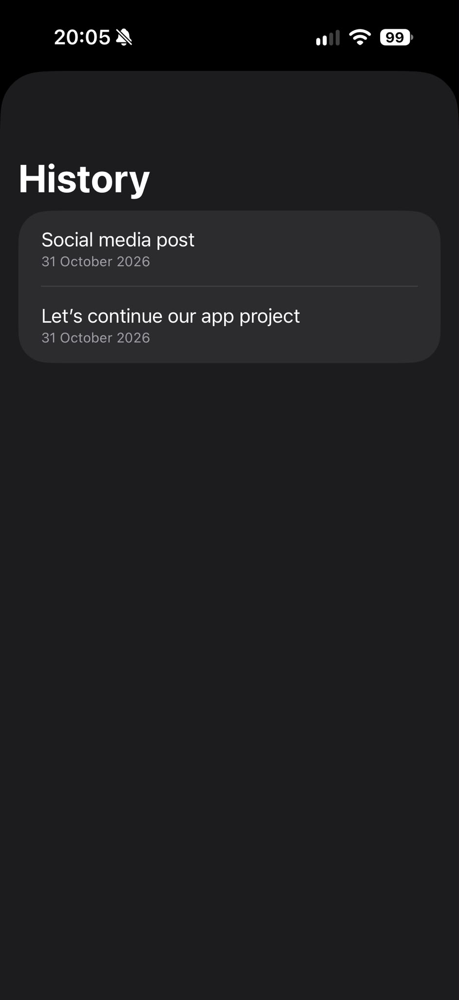
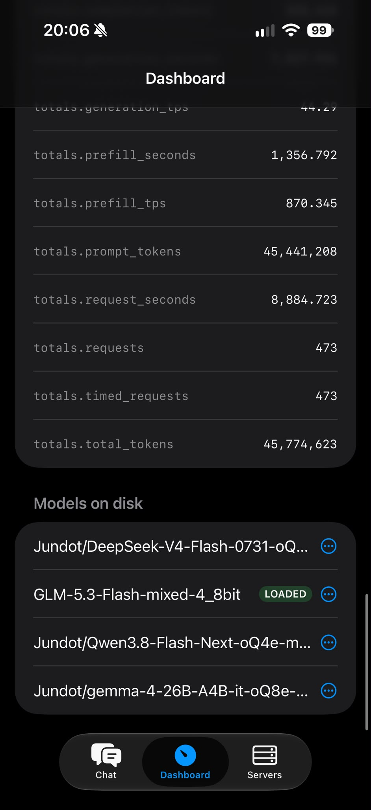

# oMLX Mobile

A native iOS client for [oMLX](https://omlx.ai) — your own local LLM server on a Mac Studio — reachable from anywhere via [Tailscale](https://tailscale.com). Works with **any OpenAI-compatible server**: oMLX, LM Studio, llama.cpp server, Ollama, vLLM…

## Features

- **Streaming chat** (SSE) with markdown rendering and stop button
- **Multiple server profiles** — e.g. tailnet URL for travel, LAN IP at home
- **API keys stored in the iOS Keychain**, never in plaintext
- **Model picker** fetched live from `/v1/models`
- **Conversation history** (SwiftData, stored on-device)
- **Server health panel** (`/health`) with oMLX engine details
- Zero third-party dependencies — pure SwiftUI + SwiftData + URLSession

## Screenshots

| Chat | Dashboard | Servers |
|---|---|---|
|  |  |  |

## Why

Local LLM servers are bound to one machine. oMLX + Tailscale turns a Mac into a private LLM endpoint; oMLX Mobile is the pocket front-end: full-rate access to your own models (GLM, DeepSeek, Qwen, whatever your server hosts) without any cloud.

## Build

Requirements: Xcode 15+ (iOS 17.6 SDK), [XcodeGen](https://github.com/yonaskolb/XcodeGen) (`brew install xcodegen`).

```bash
xcodegen generate
open oMLXMobile.xcodeproj
```

Then in Xcode: select the `oMLXMobile` target → Signing & Capabilities → choose your team (a free Apple ID works for personal installs) → plug in your iPhone → Run.

## Setup on first launch

1. **Servers → +**, give it a name and base URL:
   - oMLX over Tailscale: `https://your-mac.tailnet123.ts.net`
   - oMLX on LAN: `http://192.168.x.x:8000`
   - LM Studio: `http://<ip>:1234` · Ollama: `http://<ip>:11434`
2. Paste the API key (from the oMLX app UI, or the server's `--api-key`).
3. **Test connection** → pick a default model → **Save**.
4. Chat.

## Security notes

- Keys are kept in the Keychain (generic password, per-profile).
- Prefer HTTPS endpoints (Tailscale Serve gives you valid TLS for free with `tailscale serve --bg <port>`).
- Plain-HTTP LAN endpoints are allowed via `NSAllowsLocalNetworking` — fine on trusted home networks.

## Roadmap

- Anthropic-style `/v1/messages` endpoint mode
- Voice input / Siri Shortcuts
- Image attachments (vision models)
- iPad layout
- App Store / TestFlight distribution

## License

MIT — see [LICENSE](LICENSE).